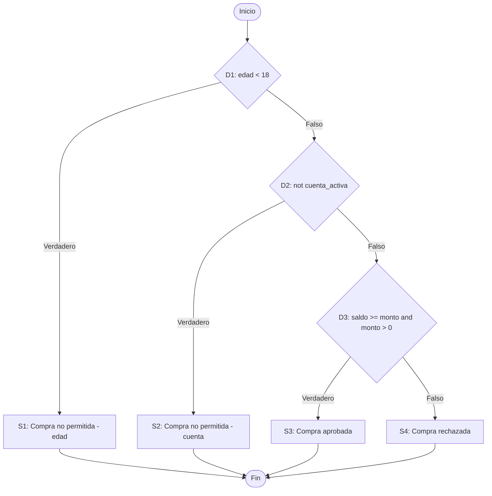

# Análisis de Caja Blanca — `validar_compra`

**Materia:** Testing & Quality Assurance (TQA) · **Examen Práctico Hito 3**
**Estudiante:** Cris Kleber Ballon Chipana

---

## 1. Código analizado

```python
def validar_compra(edad, cuenta_activa, saldo, monto):
    if edad < 18:
        return "Compra no permitida: edad"

    if not cuenta_activa:
        return "Compra no permitida: cuenta"

    if saldo >= monto and monto > 0:
        return "Compra aprobada"

    return "Compra rechazada"
```

| Aspecto | Detalle |
|---|---|
| **Entradas** | `edad`, `cuenta_activa`, `saldo`, `monto` |
| **Salidas posibles** | "Compra no permitida: edad", "Compra no permitida: cuenta", "Compra aprobada", "Compra rechazada" |
| **Regla de negocio** | Un menor de edad no compra; una cuenta inactiva no compra; la compra se aprueba solo si el saldo cubre el monto y el monto es positivo |

## 2. Identificación de decisiones y condiciones

### 2.1 Decisiones

| ID | Decisión | Posible resultado |
|---|---|---|
| D1 | `edad < 18` | Verdadero → `return` de edad · Falso → continúa a D2 |
| D2 | `not cuenta_activa` | Verdadero → `return` de cuenta · Falso → continúa a D3 |
| D3 | `saldo >= monto and monto > 0` | Verdadero → `return` aprobada · Falso → `return` rechazada |

### 2.2 Condiciones simples

| ID | Condición simple | Pertenece a |
|---|---|---|
| c1 | `edad < 18` | D1 |
| c2 | `not cuenta_activa` | D2 |
| c3 | `saldo >= monto` | D3 |
| c4 | `monto > 0` | D3 |

D1 y D2 son decisiones con **una sola condición**. D3 es una **decisión compuesta** con dos condiciones unidas por `and`. Por eso la cobertura de decisiones y la de condiciones **no son lo mismo**.

### 2.3 Sentencias

| ID | Sentencia |
|---|---|
| S1 | `return "Compra no permitida: edad"` |
| S2 | `return "Compra no permitida: cuenta"` |
| S3 | `return "Compra aprobada"` |
| S4 | `return "Compra rechazada"` |

## 3. Grafo de flujo de control



### Complejidad ciclomática

- Por decisiones: V(G) = decisiones + 1 = 3 + 1 = **4**
- Por condiciones simples: V(G) = condiciones + 1 = 4 + 1 = **5**

El valor 4 coincide con el número de caminos independientes del grafo:

| Camino | Recorrido | Sentencia alcanzada |
|---|---|---|
| P1 | D1 = V | S1 |
| P2 | D1 = F → D2 = V | S2 |
| P3 | D1 = F → D2 = F → D3 = V | S3 |
| P4 | D1 = F → D2 = F → D3 = F | S4 |

## 4. Criterio de cobertura utilizado

**Criterio principal: cobertura de decisiones** — cada decisión debe tomar los resultados verdadero y falso al menos una vez.

Para contrastar, se calcula también el mínimo de los otros dos criterios:

| Criterio | Definición | Mínimo de casos | Cálculo |
|---|---|---|---|
| Sentencias | Ejecutar cada sentencia relevante al menos una vez | **4** | Hay 4 `return` y cada uno solo se alcanza por un camino distinto |
| Decisiones | Cada decisión es verdadera y falsa al menos una vez | **4** | D1 = V termina la ejecución, así que D2 = V exige otro caso; D3 = V y D3 = F exigen dos casos más: 1 + 1 + 1 + 1 |
| Condiciones | Cada condición simple es verdadera y falsa al menos una vez | **5** (4 en teoría) | Ver sección 7 |

> **No existe un mínimo universal:** depende del código y del criterio. Aquí, con cualquiera de los tres criterios, **3 casos no alcanzan**.

## 5. Casos de prueba diseñados (3 casos solicitados)

| Caso | edad | cuenta_activa | saldo | monto | Resultado esperado | Decisión / sentencia que cubre |
|---|---|---|---|---|---|---|
| CB-01 | 17 | True | 100 | 50 | "Compra no permitida: edad" | D1 = V · S1 |
| CB-02 | 25 | False | 100 | 50 | "Compra no permitida: cuenta" | D1 = F, D2 = V · S2 |
| CB-03 | 25 | True | 100 | 50 | "Compra aprobada" | D2 = F, D3 = V · S3 |

### 5.1 Cobertura lograda con 3 casos

| Criterio | Cubierto | Total | Porcentaje | ¿Se alcanza? |
|---|---|---|---|---|
| Sentencias | S1, S2, S3 | 4 | 75 % | No (falta S4) |
| Decisiones | D1 V/F, D2 V/F, D3 V | 6 resultados | 83,3 % | No (falta D3 = F) |
| Condiciones | c1 V/F, c2 V/F, c3 V, c4 V | 8 resultados | 75 % | No (faltan c3 = F y c4 = F) |

### 5.2 Ajuste necesario

Se agrega un **cuarto caso** que haga falsa la decisión D3:

| Caso | edad | cuenta_activa | saldo | monto | Resultado esperado | Decisión / sentencia que cubre |
|---|---|---|---|---|---|---|
| CB-04 (ajuste) | 25 | True | 30 | 50 | "Compra rechazada" | D3 = F · S4 |

Con CB-01 a CB-04 se logra **100 % de cobertura de sentencias y de decisiones**.

## 6. Matriz de cobertura de decisiones

| Caso | D1 | D2 | D3 | Sentencia |
|---|---|---|---|---|
| CB-01 | V | — | — | S1 |
| CB-02 | F | V | — | S2 |
| CB-03 | F | F | V | S3 |
| CB-04 | F | F | F | S4 |

Cada decisión toma ambos valores: D1 (CB-01 / CB-02), D2 (CB-02 / CB-03) y D3 (CB-03 / CB-04). El guion indica que la decisión no se evalúa en ese caso porque la ejecución terminó antes.

## 7. Cobertura de condiciones

### 7.1 Tabla de verdad de D3

| c3 `saldo >= monto` | c4 `monto > 0` | D3 | Ejemplo | Alcanzable en Python |
|---|---|---|---|---|
| V | V | V | saldo 100, monto 50 | Sí |
| V | F | F | saldo 100, monto 0 | Sí |
| F | V | F | saldo 30, monto 50 | Sí |
| F | F | F | saldo -10, monto -5 | Sí, pero c4 no se evalúa por cortocircuito |

### 7.2 Efecto del cortocircuito de `and`

En Python, `a and b` no evalúa `b` si `a` es falsa. Por eso c4 (`monto > 0`) solo se evalúa cuando c3 es verdadera, y para observar c4 = F hace falta un caso con c3 = V y `monto <= 0`.

### 7.3 Casos para cobertura de condiciones

| Caso | edad | cuenta_activa | saldo | monto | c1 | c2 | c3 | c4 | Resultado esperado |
|---|---|---|---|---|---|---|---|---|---|
| CB-01 | 17 | True | 100 | 50 | V | — | — | — | "Compra no permitida: edad" |
| CB-02 | 25 | False | 100 | 50 | F | V | — | — | "Compra no permitida: cuenta" |
| CB-03 | 25 | True | 100 | 50 | F | F | V | V | "Compra aprobada" |
| CB-04 | 25 | True | 30 | 50 | F | F | F | — | "Compra rechazada" |
| CB-05 | 25 | True | 100 | 0 | F | F | V | F | "Compra rechazada" |

Con los cinco casos, c1, c2, c3 y c4 toman verdadero y falso al menos una vez: **8 de 8 resultados (100 %)**. Con CB-01 a CB-04 se llega a 7 de 8 (87,5 %).

### 7.4 Diferencia entre decisiones y condiciones

Con CB-01 a CB-04 la cobertura de decisiones ya es completa, pero la de condiciones no, porque c4 nunca fue falsa. Cubrir las condiciones sin cubrir las decisiones también es posible en otros códigos, por eso son criterios distintos.

## 8. Casos adicionales de valores límite (opcionales)

Refuerzan la prueba en los bordes de cada condición:

| Caso | edad | cuenta_activa | saldo | monto | Resultado esperado | Qué verifica |
|---|---|---|---|---|---|---|
| CB-06 | 18 | True | 100 | 50 | "Compra aprobada" | Límite de edad: 18 ya puede comprar |
| CB-07 | 25 | True | 50 | 50 | "Compra aprobada" | Límite de saldo: saldo igual al monto |
| CB-08 | 25 | True | 49 | 50 | "Compra rechazada" | Un peso menos que el monto |
| CB-09 | 25 | True | 100 | -10 | "Compra rechazada" | Monto negativo |

## 9. Automatización con pytest (evidencia ejecutable)

Guardar el código en `validar_compra.py` y las pruebas en `test_validar_compra.py`:

```python
import pytest
from validar_compra import validar_compra


@pytest.mark.parametrize(
    "edad, cuenta_activa, saldo, monto, esperado",
    [
        (17, True, 100, 50, "Compra no permitida: edad"),     # CB-01
        (25, False, 100, 50, "Compra no permitida: cuenta"),  # CB-02
        (25, True, 100, 50, "Compra aprobada"),               # CB-03
        (25, True, 30, 50, "Compra rechazada"),               # CB-04
        (25, True, 100, 0, "Compra rechazada"),               # CB-05
    ],
)
def test_validar_compra(edad, cuenta_activa, saldo, monto, esperado):
    assert validar_compra(edad, cuenta_activa, saldo, monto) == esperado
```

Comandos para ejecutar y medir cobertura:

```bash
pip install pytest pytest-cov
pytest -v
pytest --cov=validar_compra --cov-branch --cov-report=term-missing
```

`coverage.py` mide **sentencias y ramas (decisiones)**; no mide cobertura de condiciones simples, que se justifica con las tablas de este documento.

**Resultado de la ejecución** (Python 3.12.3, pytest 9.1.1, pytest-cov 7.1.0, Linux): los 5 casos pasaron.

```text
$ pytest -v
test_validar_compra[17-True-100-50-Compra no permitida: edad] PASSED   [ 20%]
test_validar_compra[25-False-100-50-Compra no permitida: cuenta] PASSED [ 40%]
test_validar_compra[25-True-100-50-Compra aprobada] PASSED             [ 60%]
test_validar_compra[25-True-30-50-Compra rechazada] PASSED             [ 80%]
test_validar_compra[25-True-100-0-Compra rechazada] PASSED             [100%]
5 passed in 0.01s

$ pytest --cov=validar_compra --cov-branch --cov-report=term-missing
Name                Stmts   Miss Branch BrPart  Cover   Missing
validar_compra.py       8      0      6      0   100%
TOTAL                   8      0      6      0   100%
```

| Casos ejecutados | Sentencias omitidas | Ramas parciales | Cobertura |
|---|---|---|---|
| CB-01 a CB-03 | 1 (línea 11, `return "Compra rechazada"`) | 1 | 86 % |
| CB-01 a CB-05 | 0 | 0 | 100 % |

Con tres casos queda sin cubrir el `return` de "Compra rechazada"; con el cuarto caso se completan sentencias y ramas.

## 10. Conclusiones

- El código tiene 3 decisiones, 4 condiciones simples y 4 sentencias `return`.
- Tres casos no alcanzan ningún criterio de cobertura; se necesitan **4 casos** para sentencias y decisiones.
- La cobertura de condiciones requiere un caso más (**5**) por el cortocircuito del operador `and`.
- Los casos de valores límite complementan el análisis, pero no son necesarios para alcanzar los criterios.
